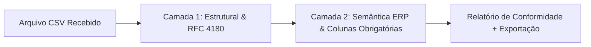

# DataConform 🛡️
> **Plataforma SaaS B2B para pré-validação, saneamento e conformidade de cargas de dados destinadas a ERPs corporativos (TOTVS Protheus, SAP Business One, Senior Sapiens, Sankhya e Oracle NetSuite).**

[](https://dotnet.microsoft.com/)
[](https://react.dev/)
[](https://www.typescriptlang.org/)
[](https://www.postgresql.org/)
[]()
[](LICENSE)

---

## Sumário
1. [Visão Geral & Proposta de Valor](#-visão-geral--proposta-de-valor)
2. [Como Funciona por Baixo dos Panos (Motor de Conformidade)](#-como-funciona-por-baixo-dos-panos-motor-de-conformidade)
3. [Fluxo de Uso da Plataforma](#-fluxo-de-uso-da-plataforma)
4. [Prévia Visual do Produto](#-prévia-visual-do-produto)
5. [Stack Tecnológica & Arquitetura](#-stack-tecnológica--arquitetura)
6. [Como Executar Localmente](#-como-executar-localmente)

---

## 🏢 Visão Geral & Proposta de Valor

Processos de migração de sistemas, fechamento contábil e importação contínua de planilhas em ERPs sofrem com arquivos fora de padrão que travam rotinas de lote ou geram inconsistências fiscais difíceis de rastrear.

O **DataConform** atua como um *Quality Gate* inteligente antes da importação no ERP:

| Desafio nas Cargas de ERP | Solução DataConform |
| :--- | :--- |
| **Quebra de Layout & Delimitadores** | Validação estrutural automática baseada na **RFC 4180**, com detecção inteligente de delimitadores (`,`, `;`, `\t`, `\|`) e codificação UTF-8. |
| **Dados Cadastrais e Fiscais Inválidos** | Inspeção semântica de **CPF/CNPJ (cálculo de dígitos verificadores Módulo 11)**, sintaxe de e-mails, valores financeiros e datas. |
| **Retrabalho Operacional** | Relatório interativo com linha, coluna, severidade e valor exato capturado, além de exportação de inconsistências em CSV pronto para correção. |
| **Governança Corporativa** | Multi-tenancy por organização, controle de cotas por plano comercial (integrado ao Stripe) e trilha de auditoria imutável. |

---

## ⚙️ Como Funciona por Baixo dos Panos (Motor de Conformidade)

Para atender diferentes ERPs e layouts de negócio sem exigir configuração complexa a cada upload, o motor do **DataConform** opera em **duas camadas complementares**:



### Camada 1: Validação Estrutural Universal (Automática)
Executada em 100% dos arquivos enviados, independentemente do ERP:
- **`COLUMN_COUNT_MISMATCH` (Erro):** Detecta linhas com colunas a mais ou a menos em relação ao cabeçalho (ex: quebra acidental por delimitador).
- **`DUPLICATE_HEADER` / `EMPTY_HEADER` (Erro):** Impede colunas duplicadas ou sem identificador no cabeçalho.
- **`ENCODING_CORRUPTION` (Aviso):** Identifica caracteres corrompidos (`\uFFFD`) oriundos de conversões ANSI/ISO-8859-1 malformadas.
- **`DUPLICATE_ROW` (Aviso):** Aponta registros 100% idênticos repetidos na mesma carga.

### Camada 2: Validação Semântica de ERP & Parametrizável
Combina heurística inteligente por nomenclatura de coluna com regras definidas pelo usuário:
- **`REQUIRED_FIELD_EMPTY` (Erro):** Valida se as colunas obrigatórias parametrizadas para o lote (ex: `codigo_cliente, razao_social, cnpj_cpf`) estão preenchidas em todas as linhas.
- **`INVALID_DOCUMENT` (Erro):** Colunas de documento (`cpf`, `cnpj`, `cnpj_cpf`, `documento`) passam por validação de máscara e cálculo matemático dos **dígitos verificadores (Módulo 11)**.
- **`INVALID_EMAIL` (Erro):** Colunas de contato (`email`, `e-mail`) são verificadas quanto ao formato `usuario@dominio.ext`.
- **`INVALID_NUMERIC_VALUE` (Erro/Aviso):** Colunas financeiras (`valor`, `preco`, `limite`, `saldo`, `total`) são validadas quanto ao formato numérico decimal e alertadas caso possuam valores negativos.
- **`INVALID_DATE_VALUE` (Erro):** Colunas temporais (`data`, `vencimento`, `emissao`) são validadas nos formatos `DD/MM/AAAA` ou `AAAA-MM-DD`.

---

## 🚀 Fluxo de Uso da Plataforma

1. **Acesso ou Modo Demonstração:** Experimente imediatamente os fluxos de leitura como visitante ou crie uma conta corporativa para habilitar uploads, validações e gestão da organização.
2. **Projetos por ERP Destino:** Organize suas cargas por projeto e sistema alvo (*TOTVS Protheus*, *SAP*, *Senior*, etc.).
3. **Upload em Lote (Drag & Drop):** Arraste múltiplos arquivos CSV simultaneamente (com limites de tamanho e lote escaláveis conforme o plano *Starter*, *Professional* ou *Enterprise*) ou baixe o **CSV de Exemplo ERP** diretamente na interface.
4. **Inspeção & Saneamento:** Defina opcionalmente as colunas obrigatórias do layout, execute a validação em tempo real, filtre ocorrências por severidade e exporte o laudo de erros em CSV.

---

## 🖥️ Prévia Visual do Produto

````carousel

<!-- slide -->

<!-- slide -->

<!-- slide -->

````

---

## 🛠️ Stack Tecnológica & Arquitetura

O projeto foi desenhado utilizando **Clean Architecture** no backend e uma SPA reativa no frontend:

```text
data-conform/
├── backend/
│   ├── DataConform.Domain/          # Entidades de negócio, Enums e contratos puros
│   ├── DataConform.Application/     # Motor CsvValidatorService, QuotaService e DTOs
│   ├── DataConform.Infrastructure/  # EF Core 10, PostgreSQL (Npgsql), BCrypt e JWT
│   ├── DataConform.Api/             # ASP.NET Core .NET 10 Minimal APIs + Scalar OpenAPI (/docs)
│   └── tests/DataConform.UnitTests/ # Suíte de testes automatizados com xUnit
└── frontend/
    └── src/
        ├── components/              # Componentes modulares (Upload, Relatório, Regras, Planos)
        ├── services/api.ts          # Cliente HTTP tipado com interceptação JWT
        └── types/index.ts           # Contratos TypeScript espelhados com os DTOs da API
```

### Principais Tecnologias
- **Backend:** .NET 10 (C#), ASP.NET Core Minimal APIs, Entity Framework Core 10, Npgsql, Autenticação JWT Bearer, BCrypt, OpenAPI 3.0 + Scalar UI (`/docs`).
- **Frontend:** React 19, TypeScript 5.9, Vite 8, Design System em CSS moderno com suporte nativo a **Light & Dark Mode** e responsividade mobile.
- **Banco de Dados & Pagamentos:** PostgreSQL 17 e integração com **Stripe Checkout** (`session_id` verification).

---

## 💻 Como Executar Localmente

### Pré-requisitos
- [.NET SDK 10.0+](https://dotnet.microsoft.com/)
- [Node.js 22 LTS+](https://nodejs.org/)
- [Docker & Docker Compose](https://www.docker.com/) (para o PostgreSQL local)

### 1. Subir o Banco de Dados (PostgreSQL 17)
```bash
git clone https://github.com/MatheusVNR/data-conform.git
cd data-conform
cp .env.example .env
docker compose up -d
```

### 2. Iniciar a API Backend (.NET 10)
As *migrations* do Entity Framework Core são aplicadas automaticamente na inicialização:
```bash
dotnet run --project backend/DataConform.Api --launch-profile http
```
- **API Base URL:** `http://localhost:5039`
- **Documentação Interativa (Scalar UI):** `http://localhost:5039/docs`
- **Especificação OpenAPI JSON:** `http://localhost:5039/openapi/v1.json`

### 3. Iniciar o Frontend (React + Vite)
Em outro terminal:
```bash
cd frontend
npm install
npm run dev
```
- **Aplicação Web:** `http://localhost:5173`

### 4. Executar os Testes Automatizados
```bash
# Testes de unidade do Backend (xUnit)
dotnet test backend/DataConform.sln

# Verificação de tipos e build de produção do Frontend
cd frontend
npm run build
```

---

## 📄 Licença

Distribuído sob a licença [MIT](LICENSE).
