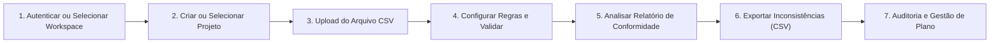
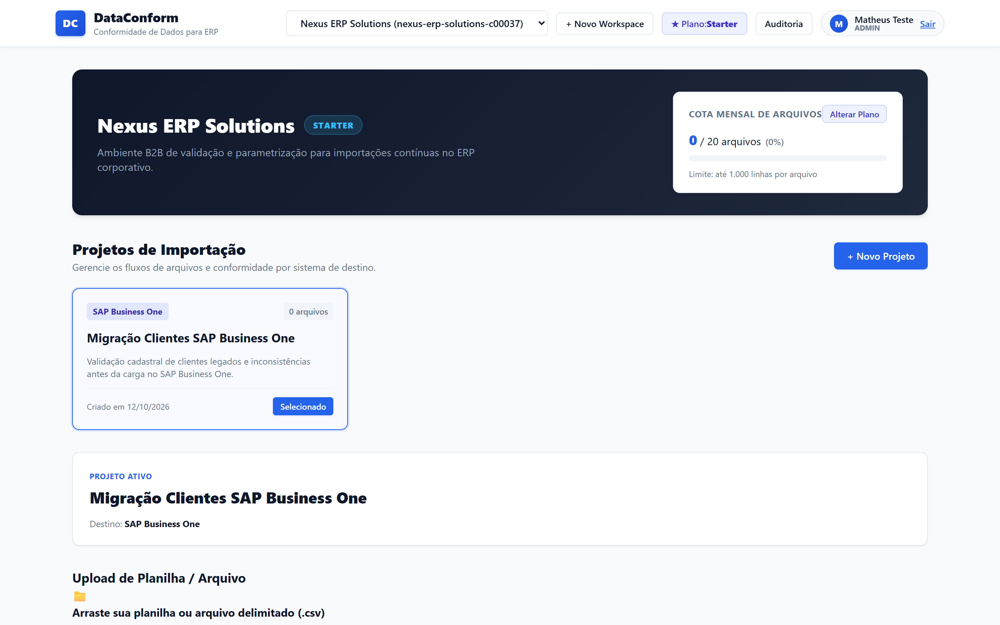
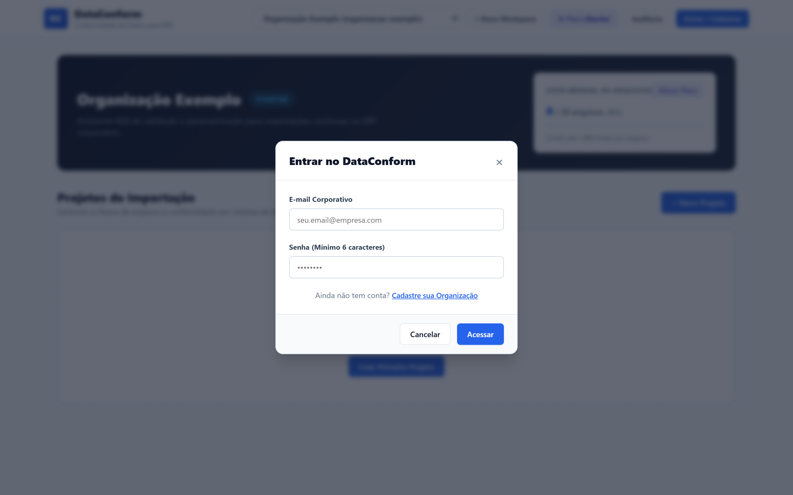
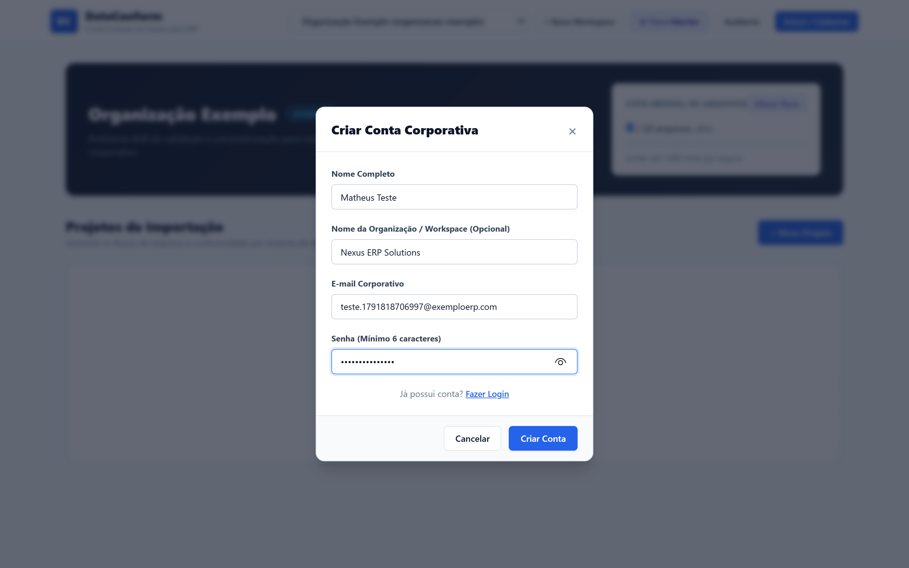
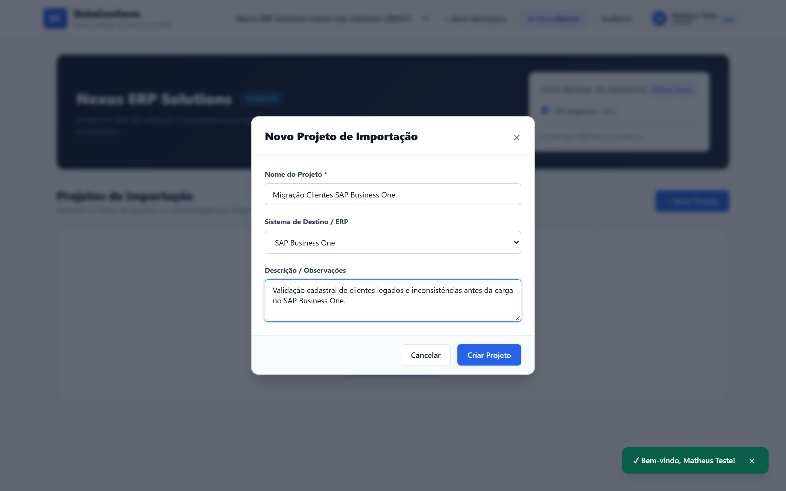
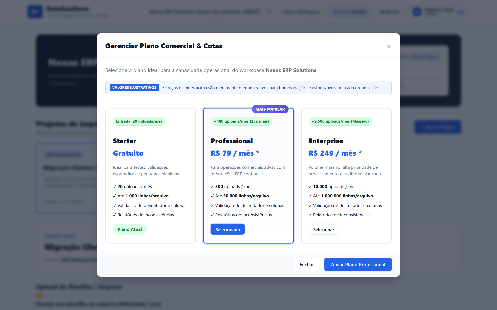
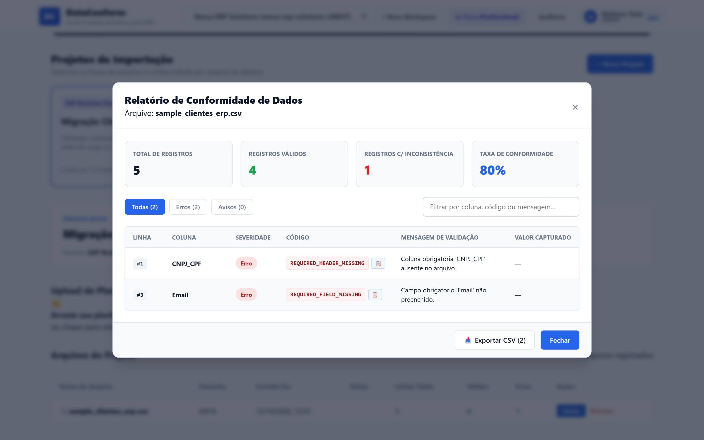
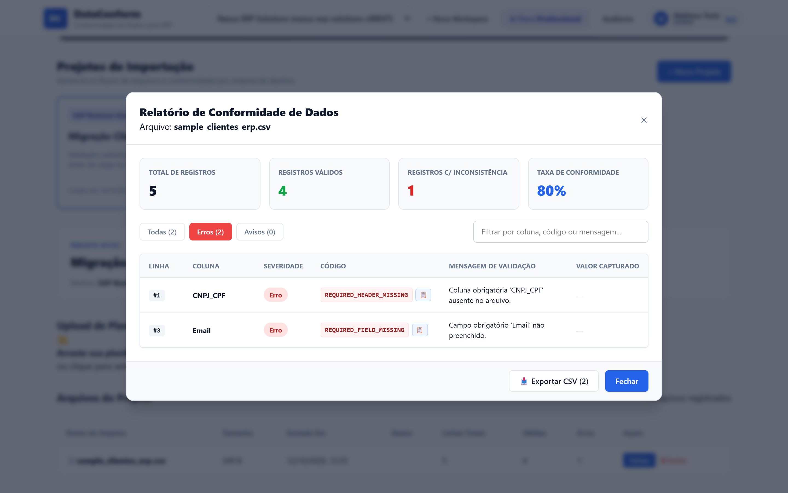
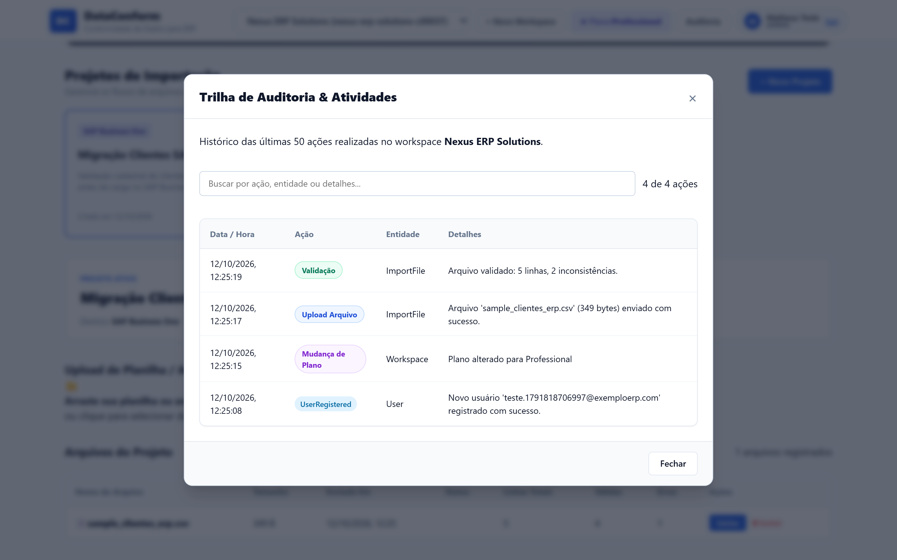

# DataConform 🛡️
> Plataforma SaaS B2B corporativa para pré-validação, conformidade e saneamento de dados para importação em ERPs (TOTVS Protheus, SAP, Senior, Sankhya e outros).

[](https://dotnet.microsoft.com/)
[](https://react.dev/)
[](https://www.typescriptlang.org/)
[](https://www.postgresql.org/)
[]()
[](LICENSE)

---

## Sumário
1. [Seção 1: Visão de Produto](#-seção-1-visão-de-produto)
   - [O Problema & Proposta de Valor](#o-problema--proposta-de-valor)
   - [Público-Alvo](#público-alvo)
   - [Mini Manual de Uso do Produto](#mini-manual-de-uso-do-produto)
   - [Demonstração Visual do Produto](#demonstração-visual-do-produto)
2. [Seção 2: Parte Técnica](#-seção-2-parte-técnica)
   - [Arquitetura de Software](#arquitetura-de-software)
   - [Padrões de Engenharia](#padrões-de-engenharia)
   - [Como Executar o Projeto Localmente](#como-executar-o-projeto-localmente)
   - [Testes Automatizados & Homologação](#testes-automatizados--homologação)
   - [Endpoints da API RESTful](#endpoints-da-api-restful)
   - [Estrutura de Diretórios](#estrutura-de-diretórios)

---

# 🏢 Seção 1: Visão de Produto

## O Problema & Proposta de Valor

Processos de migração de sistemas, fechamento contábil e importação contínua de planilhas para ERPs enfrentam gargalos que custam centenas de horas de retrabalho e riscos fiscais:
- **Tabelas corrompidas no ERP:** Campos obrigatórios em branco ou quebras de delimitador geram travamento de lote ou erros crípticos de banco de dados.
- **Falhas de tipagem e integridade:** Valores monetários com formatação incompatível, CPFs/CNPJs inválidos e strings excedendo o limite das tabelas do ERP.
- **Falta de visibilidade:** Usuários de negócio não sabem exatamente em qual linha e coluna ocorreu a inconsistência.
- **Insegurança e falta de rastreabilidade:** Arquivos trafegados sem registro de quem enviou, validou ou aprovou a carga.

O **DataConform** atua como uma barreira inteligente (*Quality Gate*) entre arquivos externos e o ERP corporativo:
- **Validação Antecipada:** Detecta delimitadores inválidos, quebras de cabeçalho, colunas ausentes e campos fora do padrão antes que o arquivo chegue ao ERP.
- **Diagnóstico em Segundos:** Relatório executivo com KPIs de conformidade, taxa de assertividade e listagem detalhada linha a linha.
- **Saneamento Imediato:** Exportação de inconsistências em CSV limpo para correção imediata e click-to-copy de códigos de erro.
- **Governança & Auditoria:** Trilha completa e imutável de todas as ações executadas no workspace.

---

## Público-Alvo
- **Consultorias de Implantação de ERP:** Reduz o tempo de homologação de bases legadas de dias para minutos.
- **Equipes de TI Corporativa:** Elimina a necessidade de criar scripts ad-hoc de validação para cada importação de planilha.
- **Controladoria, Fiscal e Financeiro:** Garante que cadastros de clientes, fornecedores e lançamentos contábeis estejam 100% corretos antes do fechamento.

---

## Mini Manual de Uso do Produto

Siga o passo a passo abaixo para operar o DataConform de ponta a ponta:



### Passo 1: Autenticação e Acesso ao Workspace
1. No cabeçalho da aplicação, clique em **"Entrar"** ou **"Criar Conta"**.
2. Preencha seus dados corporativos. Ao registrar uma conta, um workspace corporativo e um plano inicial (*Starter*) são provisionados automaticamente.
3. Se já possuir múltiplos workspaces, utilize o seletor rápido no topo da tela para alternar entre empresas ou clientes.

### Passo 2: Organização por Projetos de Importação
1. Na barra lateral esquerda, visualize os projetos existentes ou clique em **"+ Novo Projeto"**.
2. Defina o **Nome do Projeto**, **Descrição** e o **Sistema ERP Destino** (ex: *TOTVS Protheus*, *SAP Business One*, *Senior Sapiens*, etc.).
3. Clique em **"Cadastrar Projeto"**. O projeto passará a concentrar os arquivos e validações correspondentes.

### Passo 3: Envio de Arquivos (Upload Inteligente)
1. Com o projeto selecionado, localize a área de **"Upload de Planilha / Arquivo"**.
2. Arraste e solte o arquivo CSV desejado ou clique para selecionar do seu computador.
3. O sistema valida automaticamente o formato, registra o arquivo e contabiliza o uso dentro da sua cota mensal.

### Passo 4: Parametrização de Regras e Execução da Validação
1. Na tabela de arquivos do projeto, clique no botão **"Validar"** (ou **"Revalidar"** se já tiver sido processado).
2. Será exibido o modal de parametrização: informe as **Colunas Obrigatórias** exigidas pelo layout do seu ERP (ex: `Nome, CPF_CNPJ, Email, Valor`).
3. Clique em **"Executar Validação"**. O motor do DataConform processará cada registro, delimitador e campo em tempo real.

### Passo 5: Leitura do Relatório de Conformidade
1. Concluída a análise, o **Relatório de Conformidade de Dados** é exibido automaticamente:
   - **KPIs Executivos:** Total de Linhas, Registros Válidos, Registros c/ Inconsistência e Taxa de Conformidade percentual.
   - **Filtros Rápidos:** Visualize todas as ocorrências, apenas **Erros** impeditivos ou **Avisos**.
   - **Busca em Tempo Real:** Filtre instantaneamente por nome de coluna, código de erro ou termo da mensagem.
   - **Click-to-Copy:** Clique no código do erro ou no valor capturado para copiá-lo imediatamente para a área de transferência.

### Passo 6: Exportação das Inconsistências para Saneamento
1. No rodapé do relatório de conformidade, clique em **"📥 Exportar CSV"**.
2. Um arquivo `.csv` codificado em **UTF-8 com BOM** será baixado instantaneamente, contendo o número da linha, coluna, tipo de erro, mensagem e o valor original capturado, pronto para ser encaminhado à equipe responsável pela correção dos dados.

### Passo 7: Exclusão Segura, Cotas e Auditoria
- **Exclusão Segura:** Para remover arquivos desnecessários, utilize o botão **"Excluir"** na tabela; uma confirmação em duas etapas (*"Excluir? [Sim] [Não]"*) evita exclusões acidentais.
- **Gestão de Cotas & Upgrade:** Acompanhe a barra de progresso da cota mensal no banner superior. Clique em **"Alterar Plano"** para migrar entre os planos *Starter*, *Professional* e *Enterprise* conforme o volume da sua operação.
- **Trilha de Auditoria:** Clique em **"Auditoria"** no menu para visualizar o histórico cronológico de todas as ações do workspace (uploads, validações, planos, deleções) com campo de pesquisa em tempo real.

---

## Demonstração Visual do Produto

> [!NOTE]
> **Aviso sobre Dados de Demonstração & Valores Ilustrativos:**  
> Todos os nomes de usuários (ex: *Matheus Teste*), e-mails corporativos, bem como os valores monetários e planos exibidos nas telas abaixo são **estritamente demonstrativos e ilustrativos**, servindo apenas para comprovar o funcionamento dos fluxos de software e a flexibilidade comercial da plataforma. Valores e regras são livremente customizáveis por contrato.

### 1. Painel Principal & Seleção de Projetos
Visão consolidada com indicador de cota comercial, lista de projetos organizados por ERP e fila de arquivos:


### 2. Autenticação Corporativa & Multi-tenancy
Login e registro com suporte a isolamento de workspaces e planos comerciais:



### 3. Criação de Projeto Direcionado ao ERP
Definição de sistema de destino (TOTVS Protheus, SAP, Senior) e escopo de carga:


### 4. Gestão de Planos Comerciais & Capacidade Operacional
Visualização comparativa de tiers de faturamento (Starter, Professional e Enterprise) com deltas de capacidade:


### 5. Relatório de Conformidade & Diagnóstico Linha a Linha
Visualização detalhada com KPIs de conformidade, filtragem por severidade, busca textual e exportação em CSV:



### 6. Trilha de Auditoria & Governança de Dados
Registro imutável das ações operacionais do workspace com busca em tempo real e badges semânticos:


---

# ⚙️ Seção 2: Parte Técnica

## Arquitetura de Software

O DataConform é construído seguindo os princípios de **Clean Architecture**, desacoplamento por camadas e responsabilidade única:

```
┌────────────────────────────────────────────────────────┐
│                   DataConform.Api                      │  ASP.NET Core .NET 10
│  Minimal APIs • Endpoint Routing • OpenAPI • Auth JWT   │
└───────────────────────────┬────────────────────────────┘
                            │
┌───────────────────────────▼────────────────────────────┐
│               DataConform.Application                  │  Casos de Uso & DTOs
│  Validador CSV • Quota Service • Interfaces de Repositório│
└───────────────┬───────────────────────────┬────────────┘
                │                           │
┌───────────────▼─────────────┐ ┌───────────▼────────────┐
│     DataConform.Domain      │ │DataConform.Infrastructure│
│  Entidades • Enums • Regras │ │  EF Core 10 • Npgsql    │
│  Sem dependências externas │ │  PostgreSQL 17 • BCrypt │
└─────────────────────────────┘ └────────────────────────┘
```

### Componentes Técnicos
- **Backend (.NET 10 C#):**
  - **Minimal APIs:** Roteamento de alto desempenho com injeção de dependência nativa.
  - **Entity Framework Core 10 + Npgsql:** Mapeamento relacional e controle de migrações no PostgreSQL 17.
  - **Motor de Validação em Memória:** Processamento eficiente de delimitadores (`,`, `;`, `\t`, `|`), integridade de colunas e regras de obrigatoriedade.
  - **Segurança:** Autenticação via JWT Bearer e criptografia de senhas com BCrypt.
- **Frontend (React 19 + TypeScript + Vite):**
  - **React 19 & TypeScript Estrito:** 100% tipado com tipagem explícita em variáveis e assinaturas de funções (sem `any`).
  - **Vite 8:** Compilação ultra-rápida, hot module replacement e bundle otimizado.
  - **Design System Nativo em CSS Puro:** Variáveis CSS padronizadas, responsividade e ausência de dependências pesadas de UI.
- **Banco de Dados & Infraestrutura:**
  - **PostgreSQL 17 (Alpine):** Persistência relacional com Docker Compose e healthcheck com `pg_isready`.

---

## Padrões de Engenharia

1. **Tipagem Estrita e Regras de Sintaxe:**
   - No backend em C#, adoção rigorosa de **tipagem explícita** sem utilização do facilitador `var`, garantindo legibilidade e manutenção segura.
   - No frontend em TypeScript, anotações de tipo em todas as constantes, parâmetros e retornos de funções.
2. **Multi-tenancy Lógico por Workspace:**
   - Todos os projetos, arquivos, relatórios e auditorias possuem vínculo estrito com o `WorkspaceId`.
3. **Imutabilidade e Não-Destrutividade da Auditoria:**
   - A tabela de `AuditLogs` registra operações críticas de negócio (`UploadFile`, `ValidateFile`, `DeleteFile`, `ChangePlan`) de forma imutável.
4. **Governança de Limites Comerciais (Tier Quotas):**
   - O `SubscriptionQuotaService` valida dinamicamente se o workspace possui cota mensal antes de aceitar qualquer novo upload ou processar arquivos acima do limite de linhas do plano.

---

## Como Executar o Projeto Localmente

### Pré-requisitos
- [.NET SDK 10.0](https://dotnet.microsoft.com/) ou superior
- [Node.js 22 LTS](https://nodejs.org/) e npm 11+
- [Docker & Docker Compose](https://www.docker.com/) (para o banco PostgreSQL)
- [Git](https://git-scm.com/)

---

### Passo 1: Clonar o Repositório
```bash
git clone https://github.com/MatheusVNR/data-conform.git
cd data-conform
```

### Passo 2: Subir o Banco de Dados (PostgreSQL 17)
1. Crie o arquivo `.env` a partir do modelo:
   ```bash
   cp .env.example .env
   # No Windows PowerShell:
   Copy-Item .env.example .env
   ```
2. Inicie o banco de dados via Docker Compose:
   ```bash
   docker compose up -d
   ```
3. Verifique se o contêiner está saudável (`healthy`):
   ```bash
   docker compose ps
   ```

### Passo 3: Executar o Backend (.NET 10 API)
O Entity Framework aplicará as migrations automaticamente na inicialização do banco:
```bash
dotnet restore backend/DataConform.sln
dotnet run --project backend/DataConform.Api --launch-profile http
```
- A API estará disponível em: `http://localhost:5039`
- Documentação OpenAPI (Scalar/Swagger): `http://localhost:5039/openapi/v1.json`

### Passo 4: Executar o Frontend (React + Vite)
Em um novo terminal, entre na pasta do frontend:
```bash
cd frontend
npm install
npm run dev
```
- O frontend estará disponível em: `http://localhost:5173`

---

## Testes Automatizados & Homologação

### 1. Testes Unitários de Backend (xUnit)
Para executar a suíte com 18 testes cobrindo entidades de domínio, criptografia de senhas, validação de regras CSV, cotas e persistência em banco:
```bash
dotnet test backend/DataConform.sln
```
**Resultado esperado:**
```text
Aprovado! – Com falha: 0, Aprovado: 18, Ignorado: 0, Total: 18
```

### 2. Compilação e Lint do Frontend
```bash
cd frontend
npm run lint
npm run build
```
**Resultado esperado:** 0 erros de tipagem do TypeScript e bundle gerado com sucesso.

### 3. Suíte de Homologação Ponta a Ponta (E2E)
A aplicação possui script de homologação automatizada com Chromium/Edge (`frontend/scripts/homologate.mjs`) que exercita os 12 cenários de uso da aplicação e captura os prints de evidência salvos em `scripts/screenshots/`:
```bash
node frontend/scripts/homologate.mjs
```

---

## Endpoints da API RESTful

| Método | Endpoint | Descrição |
| :--- | :--- | :--- |
| `POST` | `/api/auth/register` | Cadastro corporativo de usuário e workspace |
| `POST` | `/api/auth/login` | Autenticação e geração de token JWT |
| `GET` | `/api/auth/me` | Dados do usuário autenticado no momento |
| `GET` | `/api/workspaces` | Lista workspaces aos quais o usuário tem acesso |
| `POST` | `/api/workspaces` | Criação de novo workspace |
| `GET` | `/api/workspaces/{id}/quota` | Consulta cotas de arquivos e uso mensal do plano |
| `POST` | `/api/workspaces/{id}/plan` | Atualização do plano comercial (*Starter*, *Professional*, *Enterprise*) |
| `GET` | `/api/workspaces/{id}/audits` | Consulta trilha de auditoria e ações do workspace |
| `GET` | `/api/workspaces/{id}/projects` | Lista projetos de importação do workspace |
| `POST` | `/api/workspaces/{id}/projects` | Criação de projeto de importação |
| `GET` | `/api/projects/{id}/files` | Lista arquivos enviados para o projeto |
| `POST` | `/api/projects/{id}/files/upload` | Upload de arquivo CSV com validação de cota |
| `POST` | `/api/files/{id}/validate` | Dispara motor de validação de regras e inconsistências |
| `GET` | `/api/files/{id}/report` | Retorna o relatório detalhado de conformidade do arquivo |
| `DELETE`| `/api/files/{id}` | Exclusão física do arquivo, registros e histórico associado |

---

## Estrutura de Diretórios

```text
data-conform/
├── backend/
│   ├── DataConform.sln                     # Solução .NET 10
│   ├── DataConform.Domain/                 # Entidades de Domínio, Enums e Tipos Base
│   ├── DataConform.Application/            # Interfaces, DTOs e Regras de Negócio (CsvValidator)
│   ├── DataConform.Infrastructure/         # EF Core 10, Migrations, Repositórios, BCrypt e JWT
│   ├── DataConform.Api/                    # Minimal APIs, Endpoints de Roteamento e Program.cs
│   └── tests/
│       └── DataConform.UnitTests/          # 18 Testes Unitários com xUnit
│
├── frontend/
│   ├── src/
│   │   ├── components/                     # Modais, Navbar, FileList, Uploader, Relatórios
│   │   ├── services/api.ts                 # Cliente HTTP tipado com Axios
│   │   ├── types/index.ts                  # DTOs e Interfaces TypeScript
│   │   ├── App.tsx                         # Orquestrador de telas e fluxos de estado
│   │   └── App.css                         # Design System corporativo em CSS puro
│   ├── scripts/homologate.mjs              # Script de homologação automatizada com Edge
│   └── vite.config.ts                      # Configuração do Vite
│
├── scripts/
│   ├── sample_clientes_erp.csv             # Arquivo de teste para homologação
│   └── screenshots/                        # Evidências e capturas reais das telas (01 a 12)
│
├── docker-compose.yml                      # Orquestração do PostgreSQL 17 Alpine
├── .env.example                            # Modelo seguro de variáveis de ambiente
├── .gitignore                              # Regras de exclusão de binários e segredos
└── README.md                               # Documentação central do projeto
```

---

## Licença

Este projeto está licenciado sob os termos da licença [MIT](LICENSE).
