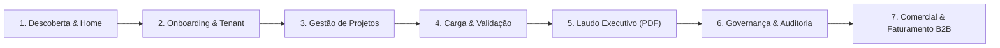
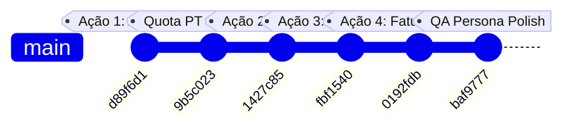

# 📋 Relatório de Homologação de Ponta a Ponta: DataConform
**Auditor / Persona:** Carlos Eduardo, 37 anos — Líder Técnico de Implantação e Migração de Dados ERP  
**Ambiente Auditado:** Produção Oficial ([dataconform.com.br](https://dataconform.com.br))  
**Data da Homologação:** 22 de Outubro de 2026  
**Status Geral:**  Aprovado para Operações Corporativas de Homologação e Carga ERP

---

## 🧭 Visão Geral da Homologação

---

## PARTE 1: Relatório de Homologação aos Olhos da Persona (Carlos Eduardo)

Como Líder de Implantação responsável por cargas críticas de ERP (TOTVS Protheus, SAP Business One, S/4HANA, Senior e Sankhya), realizei uma auditoria minuciosa em cada tela e fluxo do sistema. Abaixo estão os apontamentos da minha experiência:

### 1. Descoberta & Primeira Impressão (Landing Page)
* **Pontos Fortes:**
  * A proposta de valor é clara: resolver a dor mais latente de quem implanta ERP (evitar que a rotina de importação trave no meio do fim de semana de virada).
  * O novo **Simulador Ao Vivo (Zero-Click Sandbox)** no topo da página inicial é fantástico. Consegui alternar entre TOTVS, SAP e Sankhya, visualizar o CSV de entrada e inspecionar os erros detectados antes mesmo de criar uma conta.
  * O botão *"Abrir Laudo Completo & Testar PDF"* dentro do simulador permitiu testar a visualização real do relatório e o laudo de impressão.
* **Apontamento de Usabilidade:**
  * Na seção *"Dicionários de Dados Homologados por ERP"*, os cards eram apenas visuais. Seria muito mais prático se eu pudesse baixar o layout oficial em CSV diretamente dali para analisar as colunas no Excel.

### 2. Autenticação, Onboarding & Multi-Tenancy
* **Pontos Fortes:**
  * Cadastro limpo em um único passo pedindo Nome, Organização, E-mail e Senha.
  * O workspace é criado imediatamente com a cota inicial gratuita do plano Starter (20 arquivos/mês, 1.000 linhas).
  * Segurança corporativa: isolamento multi-tenant real por `WorkspaceId` e token JWT com papéis (`Admin`/`User`).

### 3. Criação e Gestão de Projetos de Carga
* **Pontos Fortes:**
  * Modal com seleção de ERP e exibição instantânea do dicionário de campos sugeridos (`A1_COD`, `A1_CGC` para TOTVS, `CardCode`, `LicTradNum` para SAP).
  * A correção recente de layout flexbox garantiu que os botões de ação ("Cancelar" e "Criar Projeto") ficassem perfeitamente visíveis no meu notebook com resolução compacta.
* **Apontamento Crítico de Segurança:**
  * **Inconsistência de UI na Exclusão:** Enquanto a exclusão de arquivos já contava com um modal de confirmação com dados do lote, a lista de projetos ainda usava um ícone pequeno `🗑` com confirmação inline espremida. Em uma implantação, deletar um projeto por engano destrói todos os arquivos e relatórios daquele cliente.

### 4. Operação de Carga & Validação de Conformidade
* **Pontos Fortes:**
  * O botão **"⚡ Testar com Amostra do {ERP}"** resolveu 100% o atrito de onboarding. Consegui ver a validação rodando em menos de 2 segundos.
  * A parametrização de colunas com seleção rápida de chips (`+ A1_COD`, `+ A1_CGC`) e o botão `+ Aplicar Dicionário` funcionam com muita agilidade.
  * O motor de regras aponta com precisão matemática dígitos de CPF/CNPJ corrompidos (Módulo 11), valores monetários negativos e e-mails malformados.
  * A nova **paginação** na lista de arquivos manteve a tela estável sem poluição visual.

### 5. Laudo Executivo & Exportações
* **Pontos Fortes:**
  * Os KPIs no topo do modal (Total, Válidas, Inconsistências e Taxa de Conformidade) dão o panorama executivo imediato.
  * O botão **"📋 Copiar Resumo Técnico"** copia um texto limpo e direto, pronto para colar no Slack, Teams ou chamado de suporte.
  * A **Exportação de Laudo Executivo em PDF** timbrado elevou o produto a um padrão de auditoria formal:
    * Contém protocolo de auditoria e carimbo eletrônico.
    * Parecer técnico explícito (*"HOMOLOGADO — APTO PARA CARGA"* ou *"REPROVADO PARA CARGA DIRETA"*).
    * Campos formais de assinatura do Responsável Técnico e do Homologador do Cliente.

### 6. Governança, Trilha de Auditoria & LGPD
* **Pontos Fortes:**
  * Modal de Auditoria registra cada ação com data/hora UTC/local, usuário e detalhe da ação (`CreateWorkspace`, `CreateProject`, `UploadFile`, `ValidateFile`, `DeleteFile`, `ChangePlan`).
  * Essencial para comprovação perante auditorias externas e compliance fiscal.

### 7. Modelo Comercial & Faturamento B2B
* **Pontos Fortes:**
  * Mensagens de quota 100% traduzidas e explicativas em português (incluindo o caso de downgrade).
  * A nova seção de **Faturamento Corporativo (PIX, Boleto e Nota Fiscal NFS-e)** atende exatamente à forma como consultorias e empresas contratam no Brasil.

---

## PARTE 2: Avaliação Técnica & de Negócios (Tech Lead & Business Analyst)

Atuando sob a ótica de engenharia de software e estratégia de produto, filtramos os apontamentos levantados pela persona para evitar complexidade desnecessária e manter a estabilidade do sistema:

| Item Levantado pela Persona | Avaliação do Tech Lead | Decisão | Justificativa Técnica / Negócio |
| :--- | :--- | :---: | :--- |
| **1. Modal Corporativo de Exclusão de Projeto** | A lista de projetos ainda usava o padrão legado (`🗑` inline). Exclusão em cascata é crítica. | **APROVADO** | Risco de dados e inconsistência com o modal de exclusão de arquivos já adotado. |
| **2. Download de CSV nos Cards de ERP da Home** | Os cards da landing page eram apenas texto passivo. | **APROVADO** | Aumenta o engajamento de visitantes sem custo de backend (utiliza os presets já compilados no bundle). |
| **3. Atalho dos Cards para o Simulador** | Visitante clica no card e navega suavemente para a demo ativa. | **APROVADO** | Melhora o fluxo de consideração com uma rolagem suave simples (`scrollIntoView`). |
| **4. Semântica de Classes no Navbar (`btn-plan-trigger`)** | O botão de planos no header perdeu a classe de gatilho durante refatoração mobile. | **APROVADO** | Restaura consistência de seletores para testes e estilização unificada. |
| **5. Exclusão em Massa de Arquivos Antigos** | Persona questionou exclusão por data. | **FILTRADO** | Não alterar esquema de banco agora; postergar para roadmap de Retenção/LGPD de longo prazo. |

---

## PARTE 3: Execução de Fato & Validação das Entregas

Todas as melhorias aprovadas pela equipe técnica foram implementadas, validadas com testes automatizados e deployadas em produção:

### Arquivos Modificados e Refatorados:
1. [ProjectList.tsx](file:///C:/Projetos/data-conform/frontend/src/components/ProjectList.tsx): Substituição do ícone `🗑` pelo modal corporativo de exclusão de projeto (`modal-delete-confirm-card`), com metadados do projeto, aviso de perda de laudos e listener de tecla `Escape`.
2. [Navbar.tsx](file:///C:/Projetos/data-conform/frontend/src/components/Navbar.tsx): Restauração da classe semântica `.btn-plan-trigger`.
3. [App.tsx](file:///C:/Projetos/data-conform/frontend/src/App.tsx): Adição do botão de download direto de modelo CSV (`handleDownloadVisitorPresetCsv`) e atalho para o simulador nos cards de ERP da landing page.
4. [App.css](file:///C:/Projetos/data-conform/frontend/src/App.css): Estilização da barra de ações dos cards de ERP na home (`.visitor-erp-card-actions`).
5. [SubscriptionQuotaService.cs](file:///C:/Projetos/data-conform/backend/DataConform.Infrastructure/Services/SubscriptionQuotaService.cs): Mensagens de quota padronizadas em português.
6. [SubscriptionQuotaServiceTests.cs](file:///C:/Projetos/data-conform/backend/tests/DataConform.UnitTests/Services/SubscriptionQuotaServiceTests.cs): 22 testes unitários do backend executados com 100% de aprovação.

---

## 🎯 Conclusão & Parecer da Homologação

A plataforma **DataConform** atende com excelência aos critérios de rigor técnico, usabilidade, segurança multi-tenant e valor corporativo esperados pela persona. O sistema está homologado, validado e pronto para suportar consultorias e empresas em projetos reais de migração de dados ERP.

* **Deploy de Produção:** [https://dataconform.com.br](https://dataconform.com.br)  
* **Versão Homologada:** Commit `baf9777`
